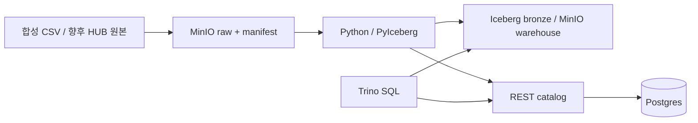

# ArchTrace

마포구 건축물의 인허가·대장·말소 이력을 연결하는 로컬 레이크하우스 프로젝트.
현재는 1주차 기반 구현이며 **합성 표제부 CSV만** 처리한다. 실제 건축HUB 파일 파서와 생애주기 분석은 아직 구현하지 않았다.



## 실행

Docker Compose, Python 3.12, uv가 필요하다. 최초 실행은 이미지와 Python 패키지 다운로드 및 MinIO 소스 빌드로 시간이 걸린다. 저장소 루트에서 실행한다.

```sh
cp .env.example .env
uv sync --locked
docker compose up -d --build
uv run python scripts/verify_smoke.py --restart
```

검증 스크립트는 카탈로그와 Trino의 준비를 기다리고, 1월 2행·2월 3행 합성 데이터를 적재한다. 재실행 결과 해시, 월별 교체, raw 체크섬, 컨테이너 재시작 후 결과를 확인한다. 테스트 전용 `bronze.synthetic_bldrgst_title`의 202601/202602 마포구 데이터를 교체하므로 이 테이블에는 업무 데이터를 넣지 않는다. 결과는 `artifacts/smoke-result.json`에 저장된다.

## 직접 적재·조회

```sh
uv run archtrace ingest-fixture tests/fixtures/title_202601.csv --snapshot 202601
uv run archtrace fingerprint
uv run archtrace verify-raw
docker compose exec -T trino trino --execute 'SELECT * FROM iceberg.bronze.synthetic_bldrgst_title'
```

추가 조회 예제: [sql/smoke_check.sql](sql/smoke_check.sql). 지역 설정: [configs/regions.yaml](configs/regions.yaml).

| 서비스 | 주소 |
|---|---|
| MinIO API | http://localhost:19000 |
| MinIO Console | http://localhost:19001 |
| REST catalog | http://localhost:18181 |
| Trino | http://localhost:18080 |

`.env.example`의 계정은 로컬 개발용이다. 데이터 API 인증키는 `.env`에만 둔다. Postgres는 호스트 포트를 공개하지 않는다. 실제 데이터·로그·실행 결과는 Git에서 제외한다.

## 검증·종료

```sh
uv run pytest -q
uv run ruff check src tests scripts
uv run ruff format --check src tests scripts
docker compose ps
docker compose logs --tail=60 rest trino
docker compose stop
```

`stop` 또는 볼륨 삭제 없는 `down`은 데이터를 유지한다. `down -v`는 원본과 카탈로그 볼륨을 삭제하므로 사용하지 않는다. 이름이 `archtrace`인 Compose 프로젝트만 제어한다.

## 설계와 진행 상황

- [원본 PRD](docs/prd.md)
- [데이터 확보 현황과 신청 준비](docs/data-sources.md)
- [합성 계약 / 실제 명세 확인 항목](docs/data-contracts.md)
- [ADR 0001: REST 카탈로그](docs/adr/0001-local-rest-catalog.md)
- [ADR 0002: raw 보존·합성 데이터 분리](docs/adr/0002-raw-and-fixture-boundary.md)
- [1주차 실행 결과와 남은 작업](docs/week-01-status.md)

다음 단계는 실제 표제부 명세·샘플을 확보해 스트리밍 파서와 품질 규칙을 확정하는 것이다. 층별·전유부 관계, PNU 변환, 말소 의미는 미확정이다. SCD2·인허가 매칭·gold·Dagster는 후속 구현이다.
